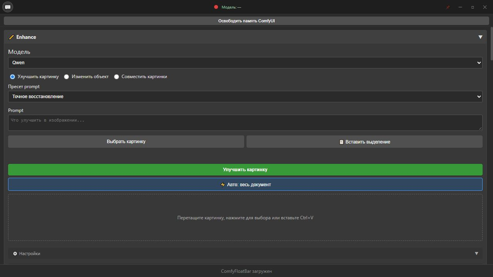
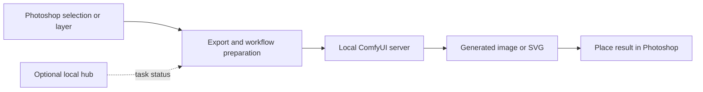

# ComfyFloatBar

**A Windows toolbar that connects Photoshop with local ComfyUI workflows.**

Export a selection, run an image workflow and place the result back into the document. ComfyFloatBar brings those steps into one floating Electron interface, alongside batch processing, mockup tools and a local task hub.



*Toolbar layout preview. Image generation and Photoshop placement require the desktop application and configured local services.*

## What it does

| Area | Capabilities |
| --- | --- |
| Photoshop bridge | Selection and layer export, result placement, transparent PNGs and SVG placement |
| ComfyUI workflows | Image generation, image editing, inpainting, outpainting, background removal and upscaling |
| Batch work | Tile processing, image variations, pattern assets and PSD mockup workflows |
| Desktop tools | Floating window, shortcuts and Photoshop window pinning |
| Local task hub | Socket.IO task status, team chat and an optional Topaz processing queue |

The application includes workflow configuration for Krea, Qwen and FLUX, with model/node checks before submission. **Model weights, API credentials, Photoshop, Topaz and private mockup libraries are not included.**

## Workflow



## Run locally

Prerequisites: Windows, Node.js 22 or newer, a compatible Photoshop installation and a running ComfyUI server with the nodes and models required by your chosen workflow. Python 3 is needed for the optional mockup server and worker tests.

```powershell
git clone https://github.com/SnowGanter/ComfyFloatBar.git
cd ComfyFloatBar
npm ci
cd mini-services/hub-service
npm ci
cd ../..
npm start
```

In the toolbar settings, configure the ComfyUI, mockup and hub endpoints. Public defaults point to **localhost**. Start with one small image and confirm the model preflight and Photoshop placement before processing a batch.

For optional Gemini prompt assistance, supply your own key before starting the application:

```powershell
$env:CFB_GEMINI_API_KEY = 'YOUR_OWN_KEY'
npm start
```

Workflow templates contain empty API-key fields; the application supplies the runtime key. No service-account keys are bundled.

- [Qwen workflow setup](qwen-workflows/README.md)
- [Optional Topaz queue](mini-services/hub-service/TOPAZ.md)
- PSD mockups: configure `DIRECTORY` in `mockup_server.py` for your own library.
- LoRA previews: optional images can be supplied locally under `assets/krea2-loras/`; missing previews are omitted.

## Build for Windows

```powershell
npm run build
npm run build:portable
```

This repository contains source, not a signed installer. Native modules and packaging require a suitable Windows development environment.

## Validation

```powershell
npm test
```

The included Node and Python tests cover workflow configuration, model preflight, image-placement calculations, pattern processing and task-queue logic. They use mocks; they do not prove that a particular GPU, model installation or Photoshop version will work. Live generation requires a separately configured environment.

## Project context

A personal visual-production and automation project developed with AI assistance. My contribution includes workflow requirements, interface decisions, image-output review and iteration. The repository demonstrates the implementation; it does not claim client sales results or measured time savings.

## Source layout

```text
main.js                    Electron window and desktop integration
renderer.js                Toolbar controls and workflow orchestration
ps_bridge.js               Photoshop integration
comfy_bridge.js            ComfyUI API integration
scripts/                   Photoshop JSX helpers
qwen-workflows/             Workflow templates and setup notes
mini-services/hub-service/  Local task hub and optional workers
tests/                     Unit checks
```

Local data, logs, network addresses, backups, dependencies and third-party model-preview artwork are excluded from this public edition. Runtime API keys belong in your own local settings. Keep the optional hub and mockup service on a trusted local network; they are not a public hosting backend.
